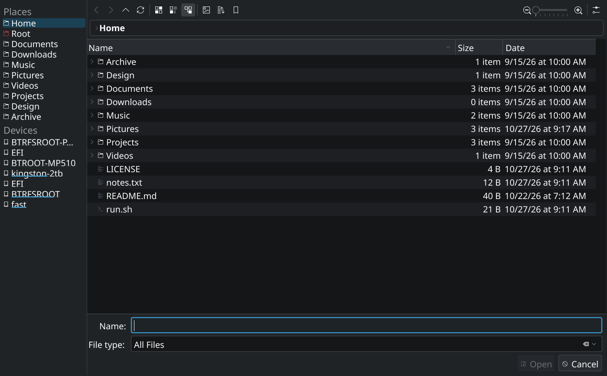
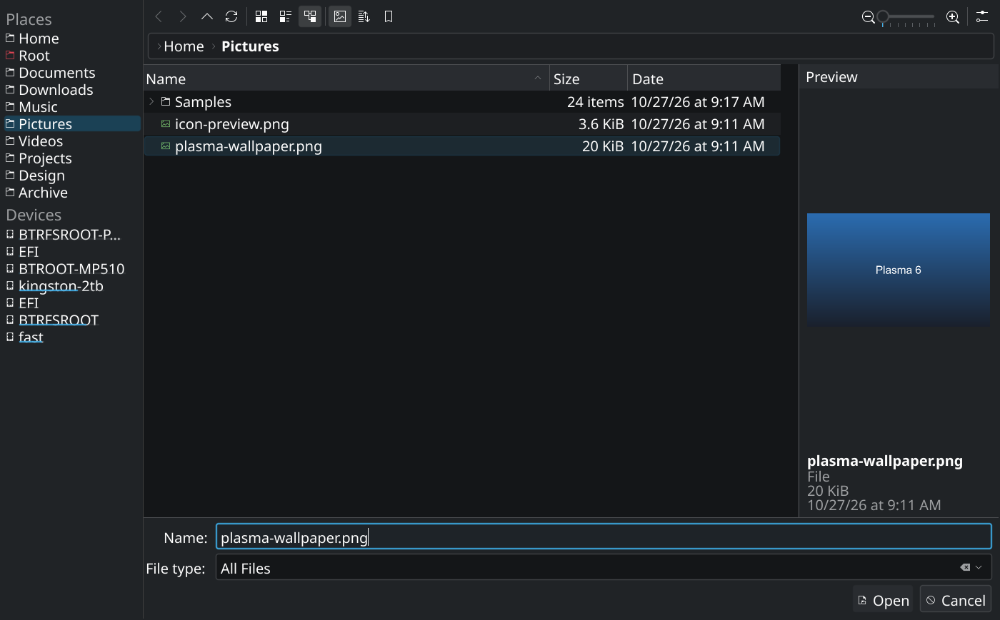
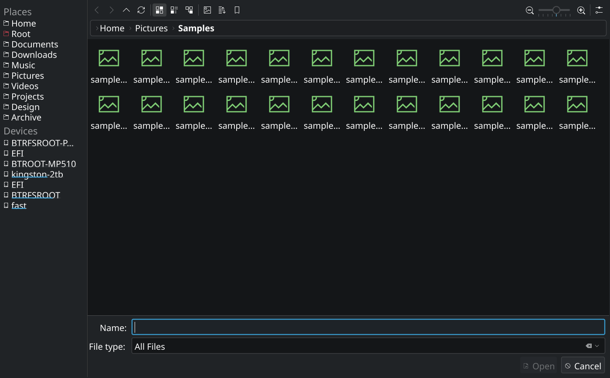
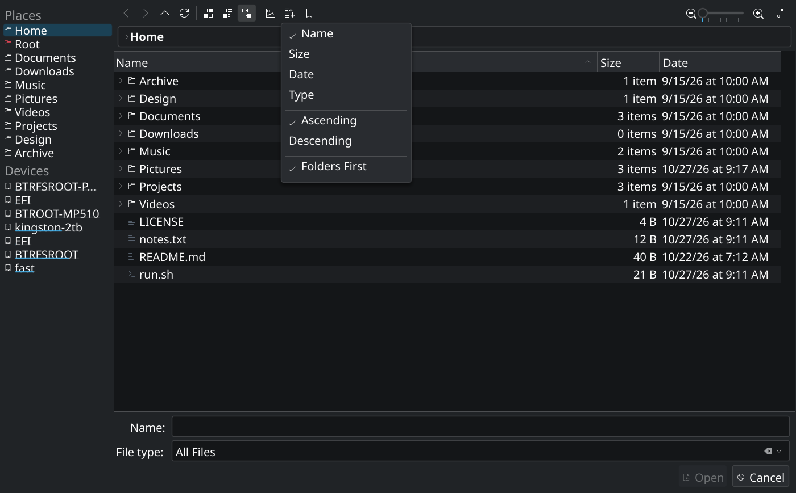
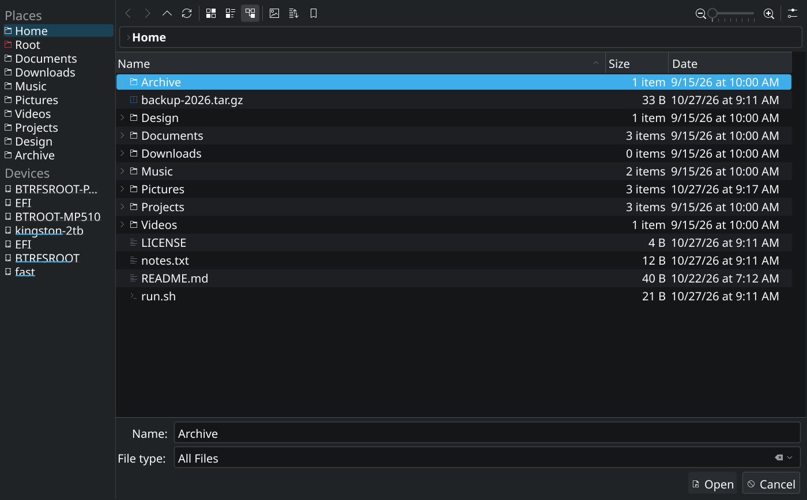

# fyne-addons

Advanced, self-contained custom objects for [Fyne](https://fyne.io) v2.

The repository starts with a pixel-faithful recreation of the **KDE 6 / Plasma
file picker**. More add-ons can live beside it, but each package is designed to
be useful on its own.

---

## KDE 6 file dialog



A complete reimplementation of KIO's `KFileWidget` file dialog in Go and Fyne.
The layout, Breeze Dark palette, Noto Sans typography, icons, row metrics,
alternating list stripes, capacity bars, scroll bars and button chrome were
measured from the real Plasma 6 dialog and from the KIO 6.31 sources on the
reference system.

It is a normal `fyne.CanvasObject`: embed it in your own window, use it as a
modal-sized window, or compose it into a larger application.

### Highlights

* **Faithful Breeze Dark appearance** — palette and metrics sampled from
  [KIO 6.31](https://invent.kde.org/frameworks/kio) and Breeze Dark.
* **Places sidebar** — reads `user-places.xbel`, keeps KDE's bookmark order,
  handles hidden entries, follows the current folder, and adds a Devices group
  with live capacity bars on Linux.
* **Breadcrumb navigation** — per-segment links, the path dropdown, and a
  `Ctrl+L` editable path mode.
* **History** — back, forward, up and reload with the same initial states as
  KDE (back/forward disabled at the start).
* **Three file views** — details, compact and icon grid. Details view supports
  an expandable folder tree; the toolbar zoom slider controls the icon grid and
  the sort menu controls field, direction and folders-first ordering.
* **Draggable chrome** — the vertical scroll bar and zoom slider support
  click-to-jump and drag tracking.
* **Single-click option** — optionally enter folders with a single click while
  keeping expander arrows available for in-place tree expansion.
* **File type filters** — arbitrary glob filters, with an optional quick
  "filter by name" row (`Ctrl+I`).
* **Preview dock** — images, SVGs, and metadata for the selected file.
* **Open, Save and Select Folder modes** — including KDE's "Open on a folder
  navigates into it" behaviour.
* **Keyboard navigation** — arrows, Home/End, Page Up/Down, Enter, Escape and
  KDE's common shortcuts.
* **No stock Fyne chrome** — the dialog's visual surfaces are drawn from
  scratch, so it does not inherit Fyne's default widget styling.
* **Embedded assets** — Breeze icons and Noto Sans travel with the binary; no
  runtime theme or icon-theme dependency.

### Screenshots

| Preview dock | Icon view |
| --- | --- |
|  |  |

The filter, sort, options, bookmarks and path dropdowns use a custom
Breeze-style menu renderer rather than Fyne's stock pop-up menu:



Details view expands folders in place; `SetSingleClickDirectories(true)` turns
folder rows into single-click navigation:



---

## Requirements

* Go 1.24 or newer
* Fyne v2.8.2 (declared by the module)
* Linux for the Devices group (`lsblk`); the rest of the dialog works on other
  desktop platforms.

### Installation

```sh
go get github.com/uidbz/fyne-addons/kdefilepicker
```

### Quick start

```go
package main

import (
	"fmt"

	"fyne.io/fyne/v2/app"

	"github.com/uidbz/fyne-addons/kdefilepicker"
)

func main() {
	a := app.NewWithID("com.example.filepicker")
	a.Settings().SetTheme(kdefilepicker.NewTheme())

	d := kdefilepicker.NewOpenDialog("")
	d.SetFilters([]kdefilepicker.Filter{
		kdefilepicker.AllFiles,
		{Name: "Images", Patterns: []string{"*.png", "*.jpg", "*.jpeg", "*.svg"}},
		{Name: "Text", Patterns: []string{"*.txt", "*.md"}},
	})

	w := a.NewWindow("Open File")
	d.SetOnAccept(func(path string) {
		fmt.Println("selected:", path)
		w.Close()
	})
	d.SetOnCancel(func() { w.Close() })

	d.ShowInWindow(w) // sets content, title, 1400x869 reference size and focus
	w.ShowAndRun()
}
```

Run the included demo:

```sh
go run ./examples/kdefilepicker
go run ./examples/kdefilepicker -save
go run ./examples/kdefilepicker -folder
go run ./examples/kdefilepicker -view icons
go run ./examples/kdefilepicker -preview -dir ~/Pictures
go run ./examples/kdefilepicker -singleclick
```

### Embedding instead of showing a window

`ShowInWindow` is a convenience helper. The dialog itself is a
`fyne.CanvasObject`, so it can be placed in any content tree:

```go
d := kdefilepicker.NewDirectoryDialog(startDir)
d.SetOnAccept(func(dir string) { /* ... */ })
d.InstallShortcuts(window) // Ctrl+L, F5, F9, Escape, Alt+Arrows, ...
window.SetContent(d)
```

The widget adapts to the size it is given. The reference screenshot is
1400×869 at 100% scale. The window title bar/decoration is intentionally left
to the operating system, just like a native KDE dialog.

---

## API overview

| API | Purpose |
| --- | --- |
| `NewOpenDialog(startDir)` | Open an existing file. |
| `NewSaveDialog(startDir, name)` | Choose a file name to save. |
| `NewDirectoryDialog(startDir)` | Select a folder. |
| `SetFilters([]Filter)` / `SetSelectedFilter(i)` | Configure and select file type filters. |
| `SetShowHidden(bool)` | Show or hide dot files. |
| `SetSingleClickDirectories(bool)` | Enter folders with a single click. |
| `SetFileName(name)` | Pre-fill the name field. |
| `SetOnAccept(func(path string))` | Called with the chosen path. |
| `SetOnCancel(func())` | Called when the dialog is cancelled. |
| `SetViewMode(ViewDetails/ViewCompact/ViewIcons)` | Switch file list presentation. |
| `SelectFile(name)` | Programmatically select an entry. |
| `ShowPreview(bool)` | Show or hide the preview dock. |
| `ShowInWindow(w)` | Show as the content of a window at the reference size. |
| `Accept()`, `Cancel()`, `RefreshDir()`, `CurrentDir()` | Control the dialog. |
| `NewTheme()` | Breeze Dark Fyne theme used by the chrome and popups. |

`Filter.Patterns` accepts shell globs. Multiple patterns may be supplied in
separate strings or separated by spaces/semicolons.

### Keyboard shortcuts

| Shortcut | Action |
| --- | --- |
| `Ctrl+L` | Edit the current location. |
| `Ctrl+I` / `Ctrl+F` | Quick filter by name. |
| `Ctrl+H` | Toggle hidden files. |
| `Ctrl+Shift+N` | Create a new folder. |
| `F5` | Reload. |
| `F9` | Toggle the places panel. |
| `Alt+Left` / `Alt+Right` / `Alt+Up` | Back / forward / up. |
| `Enter` | Open the selected file or folder. |
| `Escape` | Close quick filter/path editor, then cancel. |
| `↑` / `↓` / `Home` / `End` / `Page Up` / `Page Down` | Navigate the file list. |

### Theming

The dialog is deliberately **not** adaptive: it is a reproduction of a
specific KDE theme. Call `a.Settings().SetTheme(kdefilepicker.NewTheme())` so
transient widgets such as pop-up menus and tooltips use matching colours and
Noto Sans. The dialog's own surfaces use the sampled Breeze Dark colours
directly.

The embedded assets are:

* **Breeze Dark icons** from the KDE Breeze icon theme (LGPL-3.0-or-later).
* **Noto Sans** Regular/Bold/Italic/Bold Italic (SIL Open Font License 1.1).

See [NOTICE](NOTICE) and the licence files in `kdefilepicker/assets/`.

---

## Fidelity notes

The reference environment was Plasma 6.7.5 with KIO 6.31, the Breeze Dark
colour scheme, Noto Sans at the desktop font size, and 100% scaling. The
following details were taken directly from the KIO sources or measured from
the live dialog:

* 199 px places panel, 46 px toolbar, 37 px breadcrumb bar, 37 px column header
  and 31 px details rows.
* `#202326` window background, `#141618` view background, `#1d1f22`
  alternating rows, `#292c30` headers, `#3daee9` accent, `#1c2a32` inactive
  selection and `#1b4155` inactive places selection.
* 34 px toolbar button pitch, 22 px toolbar icons, 16 px row icons, 7 px scroll
  thumb, 37 px controls and 38 px action buttons.
* KDE's "folders first" name ordering, directory item counts, `KiB`/`MiB`
  sizes, and `M/D/YY at H:MM AM/PM` dates.
* `KFilePlacesView` section headers, rounded inactive selections, and device
  capacity bars.
* KIO's disabled `Open` button state, `KUrlNavigator` breadcrumb, `Ctrl+L`
  path editing, and the Breeze Dark inactive selection treatment.

A detailed source-to-implementation map, palette table and layout measurements
are in [docs/DESIGN.md](docs/DESIGN.md).

### Intentional limitations

* **Local filesystem only.** KIO's `smb://`, `sftp://`, `mtp://`, `timeline:`
  and search URLs are not implemented.
* **Devices are read-only.** Mounted filesystems are shown with usage bars;
  unmounted devices are listed but not mounted on click.
* **No drag and drop, inline rename, or KIO job progress dialogs.**
* **Icon theme coverage** is a curated MIME map for common file types, not the
  full shared-mime-info database.
* **Time zone** follows Go's local time by default. The reference KDE session
  displayed UTC; set `TZ=UTC` when reproducing the screenshots.

Contributions that close these gaps are welcome.

---

## Repository layout

```text
kdefilepicker/            the reusable widget
  assets/                 embedded Breeze icons and Noto Sans fonts
  dialog.go               top-level widget, navigation and acceptance
  files.go                details/compact/icon views and scrolling
  places.go               XBEL places model and sidebar renderer
  breadcrumb.go           KUrlNavigator-style breadcrumb
  toolbar.go              Breeze toolbar and zoom slider
  bottom.go               name/filter fields and action buttons
  preview.go              preview dock
  menus.go                filter/sort/bookmarks/options menus
  shortcuts.go            keyboard shortcuts
  theme.go                Breeze Dark theme and sampled palette
examples/kdefilepicker/   runnable demo
docs/screenshots/         screenshots used by this README
```

## Development

```sh
go test ./...
go vet ./...
go run ./examples/kdefilepicker
```

The tests cover directory navigation, selection, Open/Save modes, filters,
hidden files, view switching and XBEL parsing.

## Licence

The Go code is [MIT](LICENSE). The embedded Breeze icons are
LGPL-3.0-or-later; Noto Sans is licensed under the SIL Open Font License 1.1.
See [NOTICE](NOTICE).
